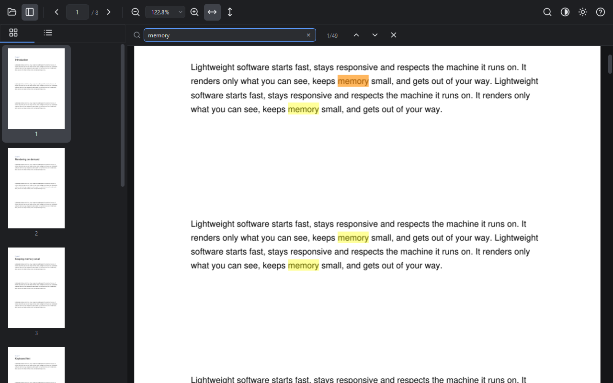

# PageWisp

A fast, lightweight PDF reader for the desktop. Keyboard-friendly, with a clean icon-only interface and light/dark themes.



## Features

- **Smooth reading:** continuous scrolling, and only the pages near the view are rendered, so large PDFs stay light on memory.
- **Auto-fit:** width, height or whole page. The page re-fits as you resize the window and stays put once you choose your own zoom.
- **Exact zoom:** type any percent (10–400%), pick a preset, or use Ctrl + mouse wheel.
- **Text selection:** select down to a single character, double-click a word, triple-click a line, and copy with Ctrl+C. Works with Thai and other scripts.
- **Search:** results update as you type, all matches are highlighted, and you can jump between them with Enter or F3.
- **Links:** internal links jump to their target (Alt+Left goes back); web links open in your browser. Links that would launch a file or program ask first.
- **Navigation:** page thumbnails, document outline, go-to-page and recent files.
- **Comfort:** dark and light themes, inverted colors for night reading, full screen, and drag-and-drop to open.

## Keyboard shortcuts

| Action | Keys |
|---|---|
| Open / sidebar | `Ctrl+O` / `Ctrl+B` |
| Find / next / previous | `Ctrl+F` / `Enter` or `F3` / `Shift+Enter` or `Shift+F3` |
| Previous / next page | `←` / `→` |
| First / last page | `Ctrl+Home` / `Ctrl+End` |
| Go to page | `Ctrl+G` |
| Back after following a link | `Alt+Left` or the mouse Back button |
| Scroll one screen | `Space` / `Shift+Space` |
| Zoom in / out | `Ctrl+=` / `Ctrl+-` or `Ctrl` + wheel |
| Type a zoom percent | `Ctrl+L` |
| Fit width / height / page | `Ctrl+0` / `Ctrl+8` / `Ctrl+9` |
| Actual size | `Ctrl+1` |
| Copy selection | `Ctrl+C` |
| Invert colors / theme / full screen | `Ctrl+I` / `Ctrl+D` / `F11` |
| All shortcuts | `F1` |

## Download

Get `PageWisp-<version>-windows.zip` from the [latest release](https://github.com/5uw1/PageWisp/releases/latest),
unzip it anywhere, and run `PageWisp.exe`. Nothing needs installing.

The executable isn't code-signed yet, so Windows SmartScreen may say *"Windows protected your PC"*
the first time. Click **More info → Run anyway**.

## Running from source

PageWisp is developed and tested on Windows. It's built on Qt and may run on macOS and Linux, but those platforms are untested.

You need [uv](https://docs.astral.sh/uv/). It installs the right Python version and all dependencies for you.

```bash
git clone https://github.com/5uw1/PageWisp.git
cd PageWisp
uv sync
uv run main.py
```

To open a file directly:

```bash
uv run main.py path/to/file.pdf
```

## Releases

Releases are built by GitHub Actions ([`build.yml`](.github/workflows/build.yml)). Every push to `main` runs
the tests and builds a dev version; pushing a tag like `v1.2.3` publishes a GitHub Release with the
Windows zip attached. The version shown in the app comes from the tag. See
[RELEASE_CHECKLIST.md](RELEASE_CHECKLIST.md).

## Building a Windows executable locally

```bash
uv run pyinstaller PageWisp.spec --noconfirm --clean
```

The app is written to `dist/PageWisp/`; run `PageWisp.exe` there. To share it, distribute the whole folder. The spec file leaves out Qt modules the app doesn't use, which keeps the build smaller.

## Running the tests

```bash
uv run pytest
```

The tests drive the real UI headlessly (Qt's offscreen platform) with simulated mouse and keyboard input, and generate the PDFs they need. Two Thai text tests run only when the Tahoma font is installed (it is by default on Windows); otherwise they are skipped.

## Project layout

```
main.py               entry point
app/
  main_window.py      window, toolbar, search bar, shortcuts, settings
  viewer.py           page view: lazy rendering, zoom/fit, selection, links
  sidebar.py          thumbnails (rendered on a background thread) and outline
  pdf_document.py     thin wrapper around PyMuPDF
  icons.py, theme.py  SVG icon set and light/dark stylesheets
tests/                pytest + pytest-qt suite
PageWisp.spec         PyInstaller build configuration
```

## Credits

PageWisp stands on the shoulders of these open-source projects:

- [PyMuPDF](https://github.com/pymupdf/pymupdf) and [MuPDF](https://mupdf.com/) by Artifex: the PDF engine (AGPL-3.0)
- [Qt 6](https://www.qt.io/) and [PySide6](https://pyside.org): the user interface (LGPL-3.0)
- [Lucide](https://lucide.dev/): the icons (ISC)
- [Python](https://www.python.org/), [PyInstaller](https://pyinstaller.org), [uv](https://github.com/astral-sh/uv), [pytest](https://pytest.org) and [pytest-qt](https://github.com/pytest-dev/pytest-qt)

The full list with licenses is in [THIRD_PARTY_NOTICES.md](THIRD_PARTY_NOTICES.md), and every release
includes an SBOM (`PageWisp-<version>-sbom.cdx.json`) listing the exact dependency versions.

## License

Copyright (C) 2026 suwijakza

PageWisp is free software: you can redistribute it and/or modify it under the terms of the
[GNU Affero General Public License v3.0](LICENSE) or (at your option) any later version.

PageWisp uses PyMuPDF, which is licensed under the AGPL. Software that includes it, like the
PageWisp executable, must be distributed under AGPL-compatible terms.
